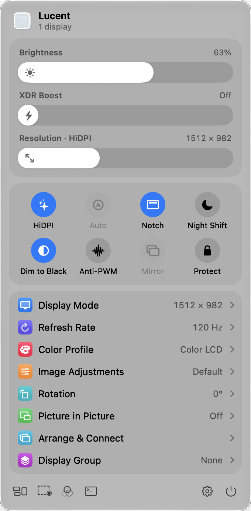
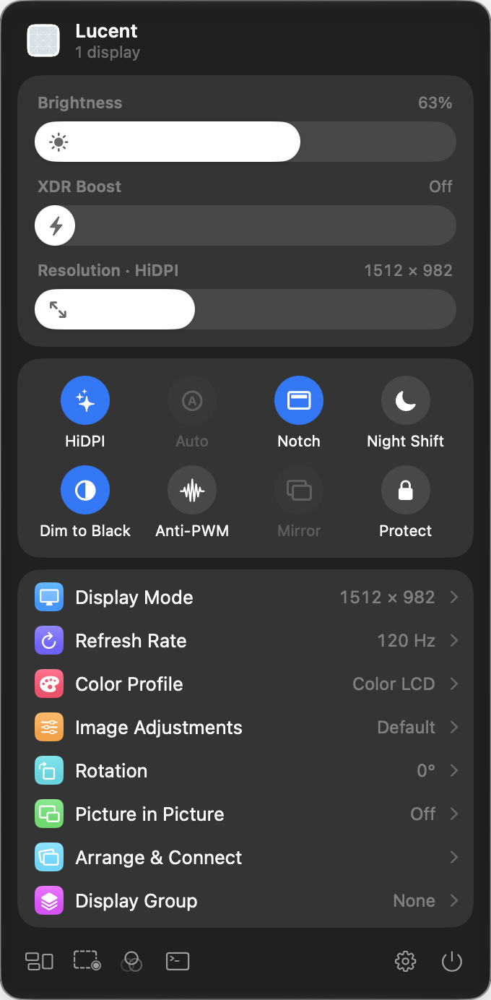
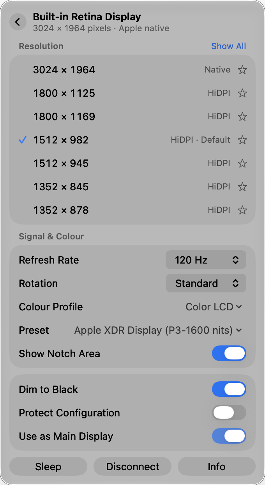
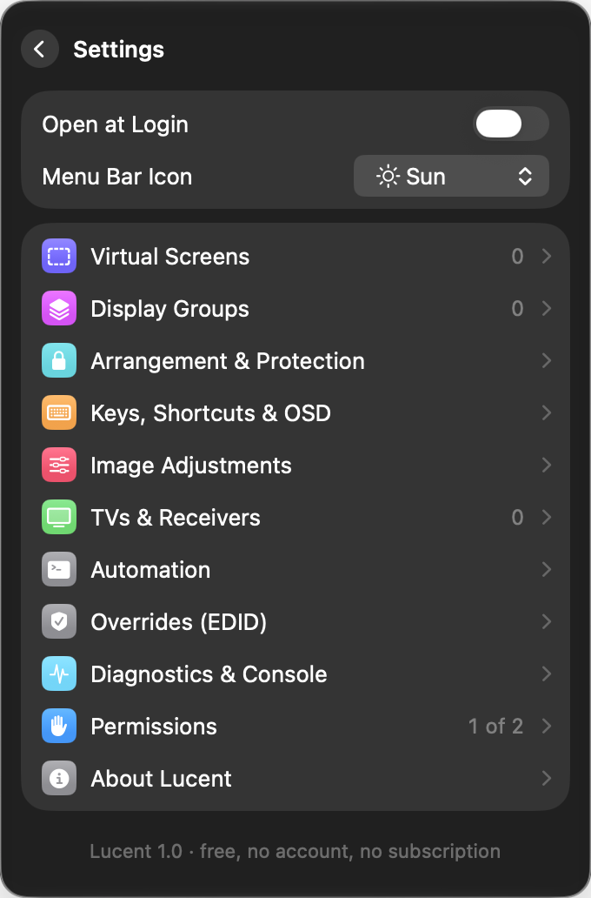

# Lucent

A native macOS menu-bar app for everything about your displays: resolution and HiDPI, brightness beyond the hardware limits, XDR boost, virtual screens, Picture in Picture, display protection, DDC control, TVs and automation. It's free, with no account, trial or subscription, and the whole app lives in one menu-bar panel.

<p>
  
  
</p>

## Features

- **Resolution:** a resolution slider, favourites (⌃⌥← / → cycles them), every HiDPI and low-resolution mode, refresh rate, rotation, notch on or off, and main display.
- **Flexible HiDPI:** any external display gets sharp HiDPI sizes. Lucent creates a HiDPI virtual screen behind the display and mirrors the display onto it.
- **Brightness:**
  - Apple displays use native control.
  - External monitors use DDC/CI on Apple silicon.
  - Everything else, including TVs and virtual screens, uses software dimming.
  - **Dim to Black** continues past the hardware minimum.
- **XDR Boost:** lifts the whole desktop to up to 1600 nits on XDR and HDR panels.
- **Hardware control (DDC):** contrast, volume, input source and standby.
- **Image adjustments:** contrast, gamma, colour temperature (Night Shift for TVs), RGB balance and invert, applied in software on any display.
- **Colour:** profile picker, Apple XDR reference presets, and Night Shift.
- **Virtual screens:** any size, aspect ratio, refresh rate and HiDPI, for headless Macs, Screen Sharing, or as a source for Picture in Picture.
- **Picture in Picture:**
  - Shows any display or window in a borderless floating window.
  - Filters: flip (teleprompter), rotate, sharpen, `.cube` 3D LUTs, frame rate, opacity, click-through, hide from screenshots.
  - Can stream one display full screen on another.
- **Arrangement & protection:** drag displays to arrange them, with edge snapping. Lucent can also put back your arrangement, resolution, refresh rate, rotation and colour profile when macOS changes them.
- **Connection:** disconnect or reconnect a display without unplugging it, keep only one display on, turn off the built-in screen when an external display connects, and reconnect everything on wake.
- **Display groups:** brightness moves together across a group, optionally matched in nits.
- **Keys & OSD:** the brightness keys work on every display (the one under the pointer). Global shortcuts, plus a modern or classic on-screen display that other apps can show too.
- **TVs & receivers:** finds devices on your network and controls volume, mute, input and power on LG webOS, Samsung Tizen, Philips (JointSpace) and Yamaha.
- **Automation:**
  - The `lucent` command-line tool, `lucent://` URLs and a local HTTP server.
  - 7 Shortcuts actions.
  - Commands or Shortcuts that run when a display connects, disconnects, sleeps or wakes.
- **Diagnostics:** modes, pixels, EDR headroom, DDC status, EDID export and display overrides, plus a console that runs commands.

<p>
  
  
</p>

## Design

- **One panel, no windows:** Settings and every tool open as pages inside the menu-bar panel. Picture in Picture is the only floating window, and it has no frame or title bar.
- **Stock controls:** SwiftUI switches, menus, sliders and capsule buttons, plus Control Center–style sliders and toggles. Liquid Glass on macOS 26 and later. Follows light/dark mode and the system accent colour.
- **Measured spacing:** a 12pt panel edge, 8pt between sections, 16pt section corners and 30pt rows. The values are in [`DesignSystem.swift`](Lucent/DesignSystem.swift).

## Command line

Install it from **Settings › Automation**, then run:

```bash
lucent list
lucent set -n builtin --brightness 40%
lucent set -n "DELL*" --resolution 2560x1440 --refresh 60
lucent virtual create --name Desk --size 3840x2160
lucent pip "Desk"
```

```bash
open "lucent://set?display=main&xdr=50"
curl "http://127.0.0.1:55777/get?display=main&brightness"
```

Run `lucent help` for the full list.

## Requirements

- macOS 14 Sonoma or later. Liquid Glass appears on macOS 26 and later.
- DDC hardware control needs an Apple silicon Mac.
- Xcode 16 or later.

## Build and run

1. Open `Lucent.xcodeproj`.
2. Run. Builds are signed ad hoc, so you don't need to choose a team.

On first launch a welcome panel asks for:

- **Accessibility:** for brightness keys on external displays, and for global shortcuts.
- **Screen Recording:** for Picture in Picture and streaming.

Local Network access is requested the first time you scan for TVs.

### Design previews

Debug builds can show any page in a borderless panel for screenshots:

```bash
Lucent.app/Contents/MacOS/Lucent -preview main dark   # main, display, settings, virtual, arrange, pip, …
```

## How it works

See [docs/SPEC.md](docs/SPEC.md) for each feature and the macOS API behind it. Some features use private macOS APIs, as every app in this category does. They are loaded at runtime, so if a future macOS removes one, only that feature turns off and the app still launches. Lucent isn't sandboxed and can't ship on the Mac App Store.
